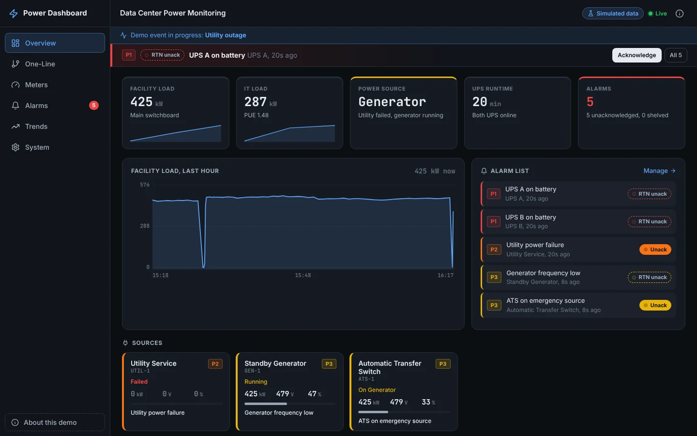
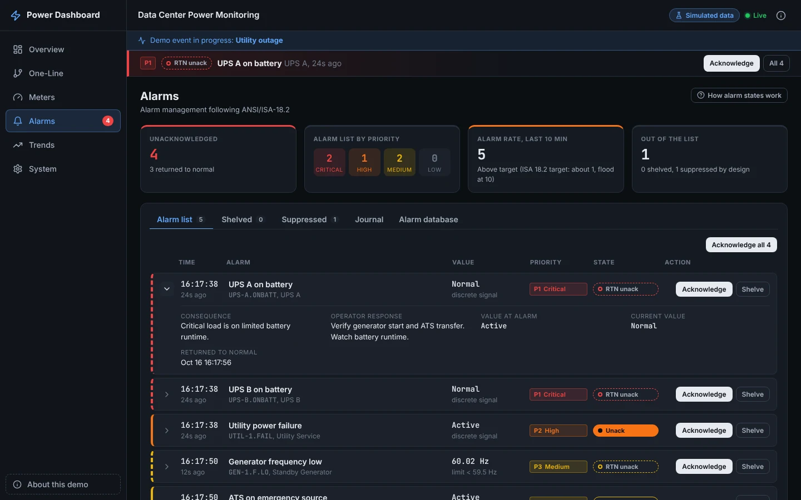
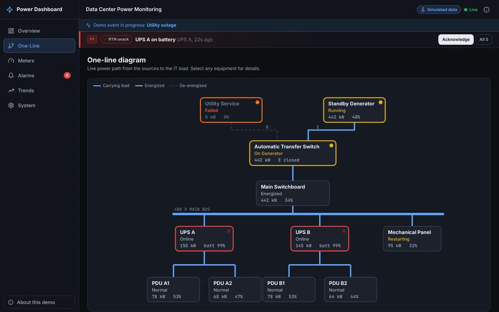
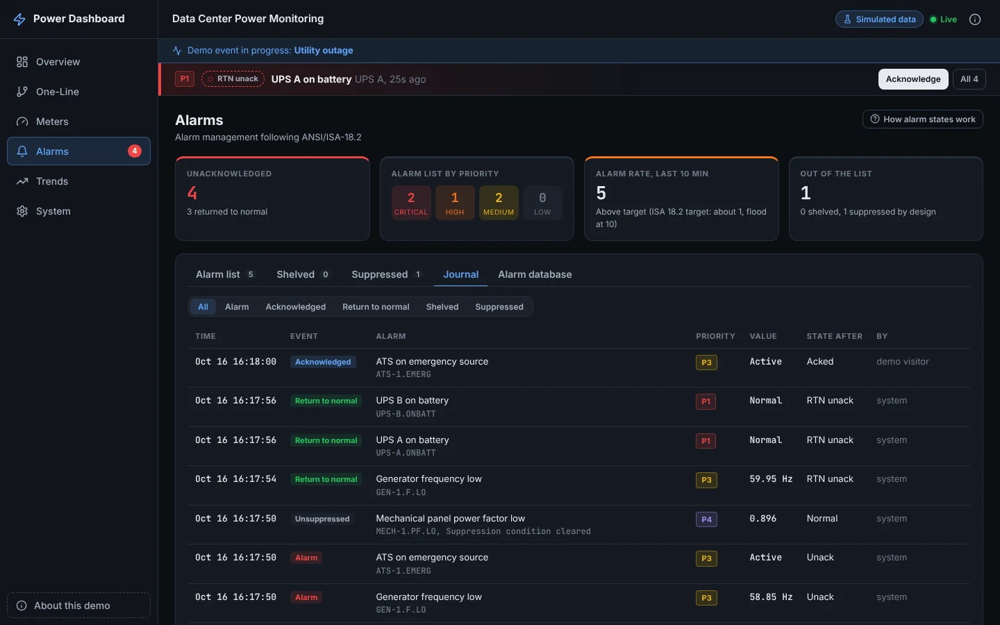
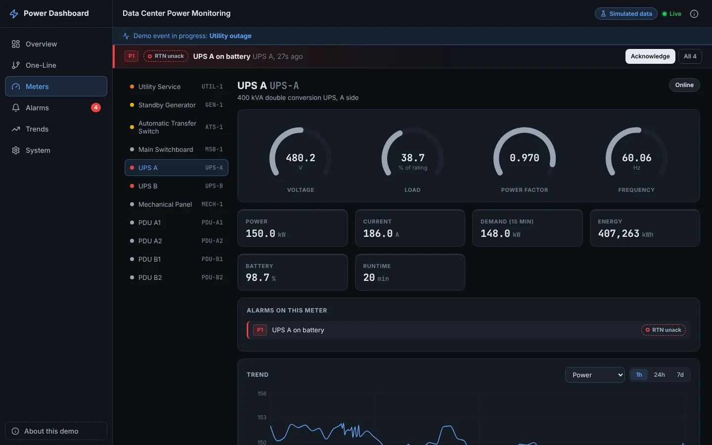
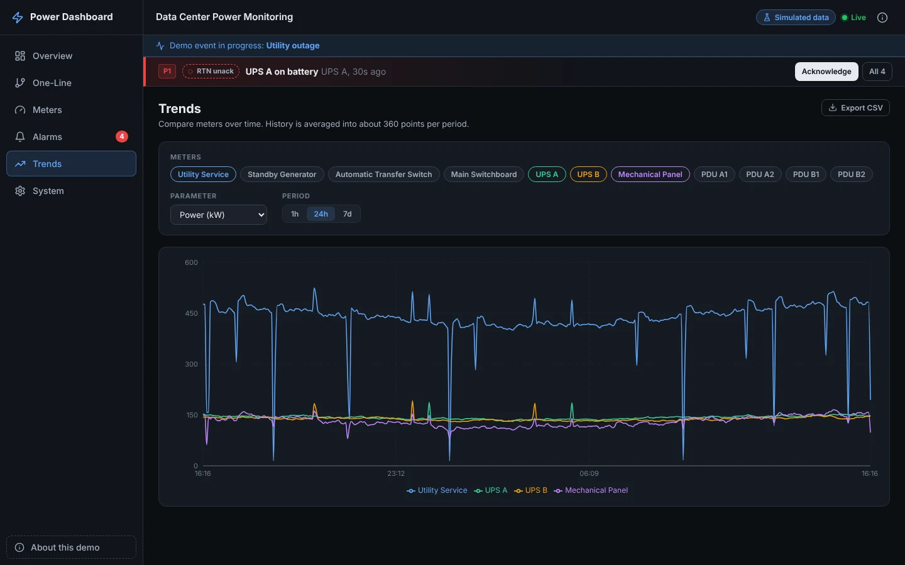
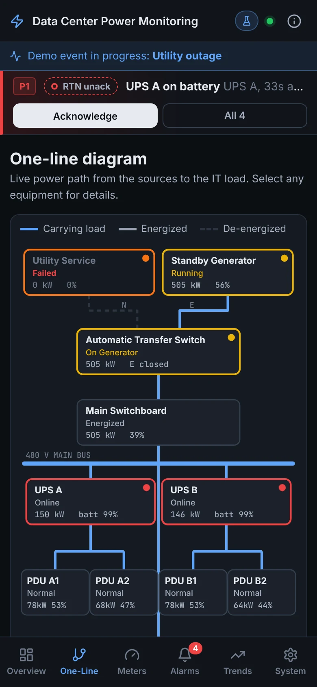

# Power Dashboard

Real time electrical power monitoring for a data center, with alarm management that follows ANSI/ISA-18.2.

### Live demo: [power-dashboard-vd3w.onrender.com](https://power-dashboard-vd3w.onrender.com)

The demo runs on **simulated data**: no real facility, customer, or equipment is connected. It is hosted on a free tier that sleeps when idle, so the first visit after a quiet period shows a short "waking up" screen for about 30 to 60 seconds. After that everything updates live every 2 seconds.



---

## What it shows

- **A simulated 2N data center.** Utility service and a standby generator feed an automatic transfer switch, then the main switchboard. Two UPS systems (A and B side) each feed two PDUs, and the cooling plant runs from its own panel. Values roll up from the IT load through transformer and UPS losses, so the numbers add up the way a real site does.
- **Equipment that behaves like equipment.** During a utility outage the UPS systems carry the IT load on battery, the generator cranks and comes up to speed, the ATS transfers, the frequency dips when the block load lands, cooling restarts, and the ATS retransfers once utility power has been stable.
- **ISA 18.2 alarm handling** with acknowledge, shelve, return to normal, designed suppression, an alarm journal, and a master alarm database. See [Alarm management](#alarm-management-isa-182).
- **A live one-line diagram** that follows the power path, showing which conductors are carrying load, energized, or dead.
- **Meter detail and trends** for every device, with 1 hour, 24 hour, and 7 day history and CSV export.
- **Alarm triage.** The dashboard raises the alarm flood; the [BMS Alarm Triage Agent](https://github.com/AddisonTech/bms-alarm-triage-agent) cuts it to a short ranked list. After an event, *Triage this event* puts the root cause first with its consequences folded underneath. See [Alarm triage](#alarm-triage).
- **Try it yourself.** Open *About this demo* and trigger a utility outage, voltage sag, PDU overload, or power factor drop. Events also happen on their own every few minutes.

---

## Alarm management (ISA 18.2)

Every alarm point runs the ISA 18.2 alarm state model:

| State | Meaning | Shown as |
|---|---|---|
| Normal | Process normal, nothing to acknowledge | Not in the alarm list |
| Unacknowledged | Process abnormal, no operator has acknowledged it | Solid priority color, flashing |
| Acknowledged | Process still abnormal, operator is responding | Steady outline |
| Returned to normal, unacknowledged | Process recovered before anyone acknowledged | Dashed outline, flashing, still needs an acknowledgement |
| Shelved | Removed from the list by the operator for a limited time with a logged reason | Shelved tab with a countdown |
| Suppressed by design | Hidden by a designed rule based on plant state | Suppressed tab with the rule shown |

```
Normal --condition--> Unacknowledged --acknowledge--> Acknowledged --clears--> Normal
                      Unacknowledged --clears--> Returned to normal, unack --acknowledge--> Normal
```

What else is implemented:

- **Rationalized master alarm database.** Each alarm has one cause, a priority, a documented consequence, and an operator response. The full table is on the *Alarm database* tab.
- **Priorities by consequence and time to respond:** Critical (under 5 min), High (under 15 min), Medium (within the shift), Low (when practical).
- **Chatter control:** deadbands (hysteresis) on analog alarms and on/off delays counted in scans.
- **Time limited shelving** (5, 15, or 60 minutes, 60 maximum). When the timer runs out the alarm returns to service and re-annunciates if the condition is still present.
- **Designed suppression:** the utility low voltage alarm is suppressed while the utility failure alarm is active, generator frequency alarms are suppressed while the generator is not running, and the cooling plant power factor alarm is suppressed while its panel is de-energized. This prevents the nuisance alarms a simple threshold system would raise during an outage.
- **Alarm journal:** every alarm, acknowledgement, return to normal, shelve, unshelve, and suppression event is recorded with time, value, and operator.
- **Performance KPIs:** annunciated alarm rate over the last 10 minutes compared with the ISA 18.2 targets (about 1 per 10 minutes acceptable, 2 manageable, 10 or more is a flood), plus counts by priority and state. The demo deliberately runs events faster than a real site, so the rate often shows "Above target".



---

## Alarm triage

ISA 18.2 alarm handling keeps the list honest, but a utility outage still annunciates six alarms in twelve seconds: utility failure, both UPS systems on battery, the generator running, the transfer switch on the emergency source, and the generator frequency dip when the load lands. Only one of those is the thing that happened.

The **Triage** tab hands the alarm journal and trend history for the window around the latest event to the [BMS Alarm Triage Agent](https://github.com/AddisonTech/bms-alarm-triage-agent), version 0.2.2, pinned in `backend/requirements.txt` to the commit that release was merged as, and shows what comes back:

- **Root cause first.** The agent's electrical rule set ranks the cause and folds its consequences under it. A utility failure explains UPS on battery, the generator start, the ATS transfer, and the frequency dip; a voltage sag explains the UPS ride through; a PDU overload explains its own lower stage and the load alarm on the UPS that feeds it; low power factor stands on its own.
- **Trend evidence** for every item, the stretch it spent past its limit, and the rule that ranked it. The generator frequency dip is measured from the load step at the transfer, once the generator is at rated frequency, never across its run up from standstill: worst frequency, how far below 60 Hz, and how long until it was back within 0.5 Hz.
- **A next step**, always a diagnostic one: a verb from a closed list, the item's own equipment as the target, never a control action.
- **Who wrote the text.** A fixed template writes it from each item's own evidence. Claude Haiku writes it only when the server has `TRIAGE_ANTHROPIC_KEY` set, and the same checks apply to every reply either way. The hosted demo has no key, so the demo shows the template.

After a demo event finishes, a *Triage this event* button appears under the top bar. On the simulated utility outage the journal holds 24 entries (6 alarms, 6 returns, and 12 acknowledgements and suppressions) and the agent returns 1 ranked item, the utility failure, with the other 5 alarms under it. A run takes about 65 ms once the agent is loaded; the first one loads it on demand so startup stays fast on the free tier.

It is read only. The agent gets a copy of the journal and history for the window and has no path back to the alarm manager or any meter.

**Time zones.** The server keeps every time in UTC with an explicit offset. The Triage tab sends the browser's time zone with each run, the agent writes every time in its text in that zone, and the tab shows every time (header, cards, consequences) in the same zone with a short label, such as `15:28:45 EDT`. The labels come from the server for each UTC offset the event touches, so the header the browser formats and the sentence the agent wrote always carry the same label. The alarm list and journal show times in the viewer's zone, labeled the same way.

| Endpoint | Time zone |
|---|---|
| `GET /api/triage/event?time_zone=America/New_York` | Returns the zone's label for each offset in the event's window |
| `POST /api/triage` with `{"time_zone": "America/New_York"}` | The agent's text uses that zone; default UTC. An unknown name is a 400 |

**The export.** `GET /api/export/journal` returns the alarm journal and trend history for a window as one JSON document in the agent's input format ([bms-triage-journal, version 1](https://github.com/AddisonTech/bms-alarm-triage-agent/blob/main/docs/JOURNAL_FORMAT.md)): every alarm point with its limit, deadband, priority, and meaning, the equipment topology, every journal entry, and the trend samples behind each point. The Triage tab links the export for the triaged window. During an event, history is stored at scan rate rather than every 10 seconds, because a voltage sag lasts a few seconds and the frequency dip about one.

| Endpoint | Purpose |
|---|---|
| `GET /api/export/journal?minutes=60` | Journal and trend history for the last N minutes (or `start` and `end`, ISO 8601), up to 24 hours |
| `GET /api/triage/event` | The latest alarm event: first and last alarm and its window |
| `POST /api/triage` | Run the agent on the latest event (or a `start` and `end` window) and return the ranked list |

---

## Screenshots

| One-line diagram during an outage | Alarm journal |
|---|---|
|  |  |
| **Meter detail** | **Trends** |
|  |  |



---

## Simulated equipment

| ID | Equipment | Rating |
|---|---|---|
| UTIL-1 | Utility service, 480 V | 1600 A |
| GEN-1 | Standby diesel generator | 750 kW |
| ATS-1 | Automatic transfer switch, open transition | 1600 A |
| MSB-1 | Main switchboard, 480 V | 1600 A |
| UPS-A, UPS-B | Double conversion UPS, A and B side | 400 kVA each |
| PDU-A1, PDU-A2, PDU-B1, PDU-B2 | PDU, 480 to 208/120 V | 150 kVA each |
| MECH-1 | Mechanical panel (CRAH units, pumps, fans) | 400 A |

Total load is about 450 kW with roughly 290 kW of IT load (PUE around 1.6). IT load follows a gentle daily profile, cooling load follows a simulated outdoor temperature, and every value drifts with slow random walks plus measurement noise.

Demo scenarios:

| Scenario | What happens |
|---|---|
| Utility outage | UPS on battery, generator start, ATS transfer, generator frequency dip, cooling restart, retransfer after 30 s of stable utility, generator cooldown |
| Utility voltage sag | Utility drops to about 85 percent for a few seconds, UPS systems ride through on battery |
| PDU overload | One PDU ramps past 80 and 90 percent load, which can also push its UPS past the 2N limit, then rebalances |
| Low power factor | The cooling plant capacitor bank drops out and power factor falls below 0.85 |

---

## Architecture

```
  Simulator  or  Modbus TCP meters
         |
         v   every 2 s
   Collector scan loop  ------------>  SQLite (history every 10 s, every scan during an event, alarm journal)
         |                                    |
         +--> Alarm manager (ISA 18.2)        +--> journal export --> BMS Alarm Triage Agent (read only)
         |                                                                     |
         v                                                                     v
   WebSocket /ws/live  ------------>  React front end  <-----  POST /api/triage, ranked list
   REST /api/*         <------------  (acknowledge, shelve, history, demo events, export)
```

- **Backend:** FastAPI. A single collector owns the scan loop, the latest readings, the alarm manager, and the set of WebSocket clients. On startup in simulation mode it generates 24 hours of history (with past events and simulated operator acknowledgements) in well under a second, so trends and the journal are never empty.
- **WebSocket feed:** on connect the server sends a `snapshot` (meters, readings, alarms, summary, demo info). After that it pushes `readings` every scan and `alarms` whenever the alarm list changes or an operator acts. Clients can send `{"type": "ping"}` and get a `pong`.
- **Front end:** React and Vite with hash based routes (`/#/alarms`), so any page can be refreshed or shared on a static host with no rewrite rules. The live feed is a single WebSocket with automatic reconnection and a stale connection watchdog. Chart heavy pages and the Triage tab are loaded on demand, so the first load is about 74 kB of gzipped JavaScript.
- **Cold starts:** the static front end never sleeps. While the API wakes up it shows a progress screen and pings `/api/health` (which is also what wakes the server), then switches to the live view as soon as the first snapshot arrives. If the connection drops later, the page keeps the last data, dims it, and shows "Reconnecting".

### Stack

| Layer | Technology |
|---|---|
| API and WebSocket | Python 3.13, FastAPI 0.111, Uvicorn |
| Storage | SQLite (WAL mode) |
| Field protocol | Modbus TCP via pymodbus (optional) |
| Alarm triage | BMS Alarm Triage Agent 0.2.2, pinned to its release commit |
| Front end | React 18, Vite 5, React Router 6 |
| Charts and icons | Recharts (trend pages), inline SVG, Lucide |
| Tests | pytest, FastAPI TestClient, Vitest |
| Hosting | Render (static site plus web service), GitHub Actions CI |

---

## Run it locally

Requirements: Python 3.11 or newer and Node 18 or newer.

**Backend** (terminal 1):

```bash
cd backend
python -m venv .venv
source .venv/bin/activate        # Windows: .venv\Scripts\activate
pip install -r requirements.txt
uvicorn main:app --reload --port 8000
```

API docs are at http://localhost:8000/docs.

**Front end** (terminal 2):

```bash
cd frontend
npm install
npm run dev
```

Open http://localhost:5173. The Vite dev server proxies `/api` and `/ws` to the backend, so no configuration is needed.

**Tests:**

```bash
cd backend && pip install -r requirements-dev.txt && python -m pytest -q
cd frontend && npm test
```

The backend suite covers the simulator (physical consistency, the outage sequence, every scenario), the alarm state machine (every ISA 18.2 transition, deadband, delays, shelving, suppression, KPIs), the WebSocket feed (snapshot, streaming, ping, live alarm updates after operator actions), the REST API, Modbus decoding, and the triage tie-in (the journal export checked against the agent's own parser, every demo scenario triaged from the real simulator, the event window, scan rate history during events, and the export and triage endpoints). The front end suite covers the feed reducer, URL handling, and the Triage tab (root cause first, consequences collapsed, trend evidence, the writer label).

---

## Configuration

Backend settings are environment variables (see `backend/config.py`):

| Variable | Default | Purpose |
|---|---|---|
| `DATA_SOURCE` | `simulator` | `simulator` for the demo, `modbus` for real meters |
| `MODBUS_CONFIG` | `modbus_config.json` | Device and register map when `DATA_SOURCE=modbus` |
| `POLL_INTERVAL` | `2` | Scan interval in seconds |
| `HISTORY_INTERVAL` | `10` | Seconds between stored history rows |
| `RETENTION_DAYS` | `7` | Days of history and journal kept |
| `BACKFILL_HOURS` | `24` | Simulated history generated at startup |
| `SIM_EVENT_MIN`, `SIM_EVENT_MAX` | `150`, `360` | Seconds between automatic demo events |
| `SIM_SEED` | random | Fixed seed for repeatable simulation |
| `DEMO_EVENTS_ENABLED` | `true` | Allow visitors to trigger events from the UI |
| `CORS_ORIGINS` | `*` | Comma separated allowed origins |
| `DB_PATH` | `power_dashboard.db` | SQLite file |
| `TRIAGE_ANTHROPIC_KEY` | unset | Optional. When set, Claude Haiku writes the triage text; otherwise the template does. Not set on the hosted demo |

Front end: `VITE_API_URL` is the API base URL used at build time. It is optional. A production build without it points at the live demo API, `https://power-dashboard-api.onrender.com`, and the dev server without it proxies to the local backend.

### Real hardware (Modbus TCP)

```bash
cd backend
pip install -r requirements-modbus.txt
cp modbus_config.example.json modbus_config.json   # edit hosts, unit ids, registers
DATA_SOURCE=modbus uvicorn main:app --port 8000
```

Each device entry maps a meter ID to a host, unit ID, and the register for each value (holding, input, coil, or discrete; `float32`, `int16`, `uint16`, `int32`, `uint32`, or `bool`; optional scale and word order). A meter that stops answering is shown as "Comm Fail" and its alarms hold their last state until communication returns. The alarm engine, history, and UI work the same as in the demo.

---

## Deployment (Render)

`render.yaml` is a Render Blueprint with two services that deploy from `main` on every merge:

- **power-dashboard-api**: Python web service in `backend/`, started with `uvicorn main:app --host 0.0.0.0 --port $PORT`, health checked at `/api/health`, running the simulator.
- **power-dashboard**: static site built from `frontend/` with `npm ci && npm run build`, published from `dist`. No dashboard settings are required: hash routes mean refreshes never 404, and the build falls back to the live API URL when `VITE_API_URL` is not set.

Build filters mean a change under `backend/` only redeploys the API, a change under `frontend/` only redeploys the site, and documentation changes redeploy nothing. GitHub Actions runs both test suites and the production build on every pull request and push to `main`.

---

## Project layout

```
backend/
  main.py               FastAPI app, REST endpoints, WebSocket
  collector.py          Scan loop, backfill, broadcast
  simulator.py          Data center power system model and scenarios
  alarms.py             ISA 18.2 alarm state machine
  config.py             Settings, topology, master alarm database
  database.py           SQLite history and alarm journal
  triage_export.py      Alarm journal export in the triage agent's format, event window
  triage.py             Runs the triage agent on the latest event
  modbus_source.py      Modbus TCP polling (optional)
  tests/
frontend/
  src/services/         WebSocket feed, REST client
  src/pages/            Overview, One-Line, Meters, Alarms, Triage, Trends, System
  src/lib/triage.js     Triage tab helpers (evidence text, chart geometry)
  src/components/       Wake screen, About panel, alarm banner, badges, charts
render.yaml             Render Blueprint
```

## License

MIT, see [LICENSE](LICENSE).
